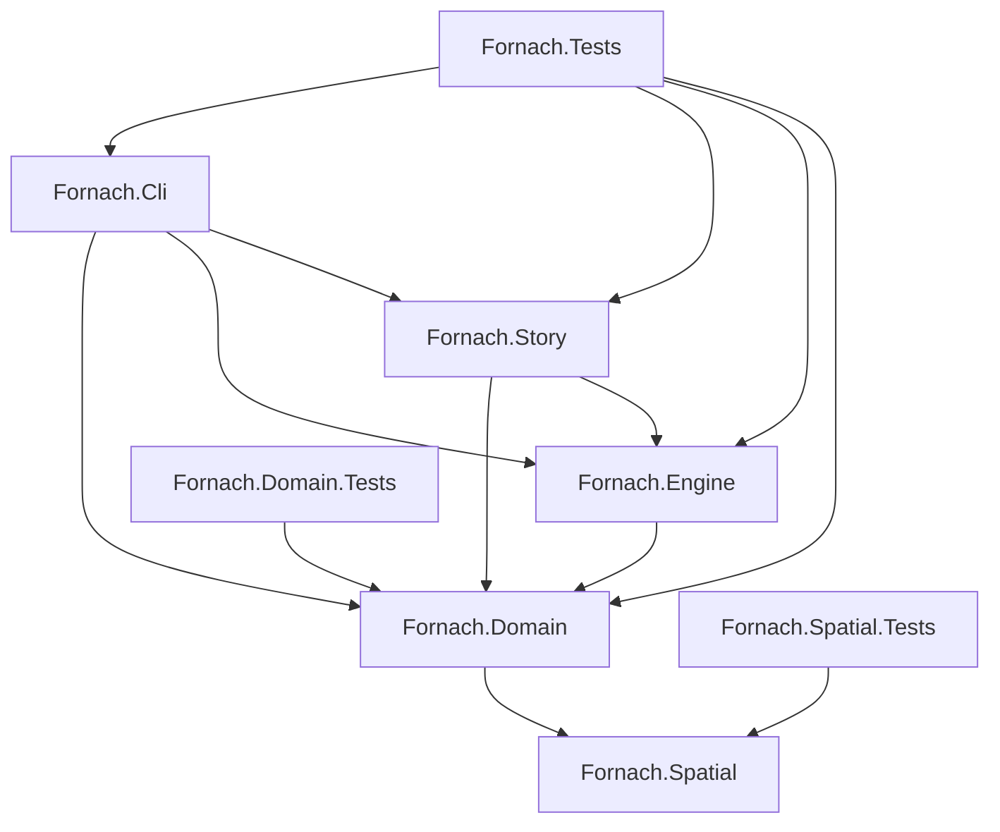

# Solution Architecture and Project Boundaries

Fornach is an extensible combat simulation and procedural roguelike engine implemented in F# on .NET 10. The solution architecture enforces strict separation of concerns, immutability, and unidirectional project dependencies across spatial geometry, domain aggregates, contest simulation, narrative progression, and terminal presentation.

## Project Structure and Dependency Hierarchy

The repository is defined by `Fornach.slnx` and consists of five core source libraries and three test projects:

### 1. Fornach.Spatial (`src/Fornach.Spatial`)
The foundational layer representing 2D grid coordinates, vector mathematics, Manhattan/Chebyshev distances, Bresenham raycasting, field of view (FOV), and line-of-sight algorithms. It carries zero dependencies on combat or game state.

### 2. Fornach.Domain (`src/Fornach.Domain`)
The core domain model containing pure data structures and mathematical definitions:
- **Stat Systems**: The 12-stat vector matrix (`Attributes.fs`, `Stats.fs`).
- **Resource Meters**: Bounded 0–100 meters (`Meters.fs`) tracking Fatigue, Overwhelm, Frustration, Confusion, and Exhaustion.
- **Combat Entities**: Immutable `Combatant` records (`Combatant.fs`), Stance representations, Equipment, and preparations.
- **Assessment Engine**: `TacticalAssessment.fs` evaluating Acumen vs. Composure to discover enemy primary stats, weaknesses, and apex threats.
- **Progression Scaling**: `TierFactory.fs` generating combatants across Tiers I through IV and Levels 1 to 200, incorporating spell armor calculations and level-based stat caps.

### 3. Fornach.Engine (`src/Fornach.Engine`)
The simulation and contest execution layer:
- **Contest System**: Opposed contest evaluation (`Contest.fs`) using logistic/sigmoid curves.
- **Combat Resolution**: `ActionResolver.fs` evaluating player and enemy actions, fluid stance shifts, status meter accumulation, and collapse states.
- **Tower Simulation**: `TowerSession.fs` and `TowerGenerator.fs` managing procedural level generation, enemy placement, and turn loops.

### 4. Fornach.Story (`src/Fornach.Story`)
The narrative engine integrating the Ink narrative format (`Qyl27.Ink.Engine`) with the combat engine. Encapsulates script execution, dialogue branches, tutorial encounters, and the five Grief Aspect bosses (Denial, Anger, Bargaining, Depression, Acceptance).

### 5. Fornach.Cli (`src/Fornach.Cli`)
The user-facing terminal interface built on `Spectre.Console`:
- Implements Vim-style keyboard navigation (`h/j/k/l`, `w/b`, `:q`).
- Dynamic combat HUD with real-time meter tracking, threat warnings, stance displays, and narrative scene renderers.
- Main application entrypoint (`Program.fs`).

## Test Suites

The codebase maintains automated verification through three test projects using xUnit and FsUnit:
- **`Fornach.Domain.Tests`**: Validates stat scaling, balance regressions, meter thresholds, and prolonged battles.
- **`Fornach.Spatial.Tests`**: Verifies grid algorithms, raycasting precision, and FOV calculations.
- **`Fornach.Tests`**: Comprehensive integration suite covering the interactive tower crawl, tutorial flow, stance shifts, and combat logger behavior.

## Build and Quality Invariants

- **Zero-Warning Policy**: All code compiles with `TreatWarningsAsErrors` enabled across all solution projects.
- **Domain Purity**: Domain and Spatial projects remain side-effect free, using immutable F# records and discriminated unions.
