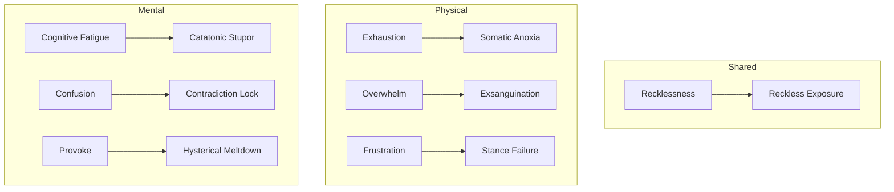

# Status Meters and Collapse Mechanics

Fornach replaces static status ailments with a dynamic, interconnected meter system. As combatants strain their bodies and minds through intense exertion, gambits, and psychological trauma, seven continuous status meters accumulate entropy.

## The Seven Combat Gauges

All meters are bounded value objects clamped between `0` and `100` (`Meters.fs`). Strain progresses through four distinct operational bands:
- **Normal** (`0% – 39%`): Unimpeded combat capability.
- **Strained** (`40% – 74%`): Noticeable exertion; early tactical warning sign.
- **Critical** (`75% – 99%`): Severe systemic vulnerability; imminent collapse hazard.
- **Collapsed** (`100%`): Complete structural or mental failure.

### 1. Shared Entropy
- **Recklessness**: Accrues from high-risk gambits (`ForceStrike true`, `FinesseCadence true`, `ProwessStrike true`). Overloading at 100% triggers `RecklessExposure` (extended to 120% for Berserkers or under `BerserkTincture`).

### 2. Physical Status Meters
- **Exhaustion**: Body stamina and respiratory capacity. Ticks up with sustained movement, heavy weapon swings, and round-over-round combat exertion. Breaching 100% causes `SomaticAnoxia`.
- **Overwhelm**: Kinetic trauma, internal bleeding, and physical pressure from incoming multi-hits and flankers. Breaching 100% causes `Exsanguination`.
- **Frustration**: Combat timing disruption, missed strikes, deflection against heavy armor, or thwarted gambits. Breaching 100% causes `StanceFailure`.

### 3. Mental Status Meters
- **Cognitive Fatigue**: Arcane overchanneling, complex spell maintenance, and psychic drain. Breaching 100% causes `CatatonicStupor`.
- **Confusion**: Perceptual dissonance, illusory deceptions (`SynapticGlamour`), and contradiction attacks. Breaching 100% causes `ContradictionLock`.
- **Provoke**: Emotional instability, taunts, psychological goading, and social contest damage. Breaching 100% causes `HystericalMeltdown`.

## Consequences of Collapse

When `Combatant.evaluateCollapse` detects any meter meeting or exceeding the 100% threshold:
1. **Defensive Rupture**: `EffectiveDefenseMultiplier` plummets to `0.25`, stripping 75% of all effective defenses.
2. **Execute Eligibility**: The combatant becomes `IsExecuteEligible = true`. Any physical or mental `Execute` strike instantly finishes the target without contest mitigation (`ActionResolver.fs`).

## Recovery via Steady Breathing

Combatants are not locked into defeat once meters climb. The **Steady Breathing** action (`ActionResolver.fs`) provides a tactical reset:
- Drains physical meters (`Exhaustion`, `Overwhelm`, `Frustration`) scaled by `Poise`.
- Drains mental meters (`CognitiveFatigue`, `Confusion`, `Provoke`) scaled by `Composure`.
- Drains `Recklessness` and restores Morale.
- If all seven meters fall below 100%, `Combatant.stabilizeCollapse` immediately clears the collapse state, returning the combatant to `Stable` and revoking execute eligibility.
