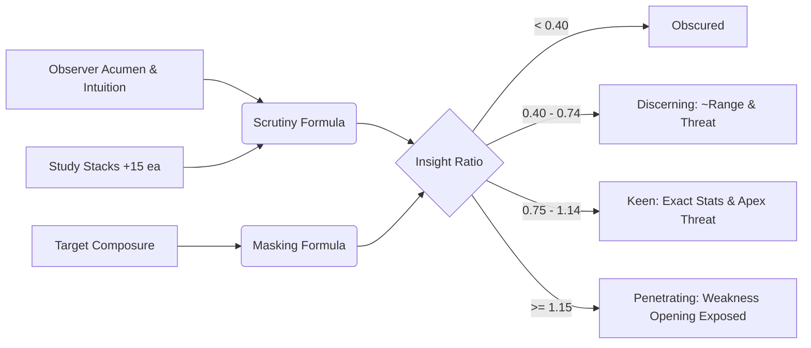

# Tactical Assessment and Threat Warnings

Rather than presenting arbitrary enemy health bars or hiding critical mechanics behind trial-and-error, Fornach implements an active perception contest via `TacticalAssessment.fs`. An observer's analytical faculties contest the target's emotional and disciplined composure to uncover combat intelligence in real time.

## Scrutiny vs. Masking Equation

An observer's analytical acuity is quantified by **Effective Scrutiny**:
$$\text{Scrutiny} = \text{Acumen} + \left\lfloor\frac{\text{Intuition}}{4}\right\rfloor + (\text{StudyStacks} \times 15)$$

- **Acumen** provides core analytical deduction (100%).
- **Intuition** provides instinctive peripheral awareness (25%).
- **Study Stacks** accrued during battle provide progressive familiarity (+15 effective Acumen per stack).

This value is divided by the target's **Effective Masking**:
$$\text{Masking} = \max(1, \text{Composure})$$

$$\text{Insight Ratio} = \frac{\text{Effective Scrutiny}}{\text{Effective Masking}}$$

## Tactical Insight Tiers

The resulting ratio unlocks four tiers of intelligence:

| Insight Level | Ratio Range | Information Revealed | Threat Warning |
| :--- | :--- | :--- | :--- |
| **Obscured** | $< 0.40$ | Target demeanor stoic and inscrutable | None |
| **Discerning** | $0.40 \le R < 0.75$ | Primary stat identity and approximate range ($\pm 20$) | `⚠ THREAT DETECTED` |
| **Keen** | $0.75 \le R < 1.15$ | Exact primary stat number and highest defense | `⚠ APEX THREAT` |
| **Penetrating** | $\ge 1.15$ | Full breakdown: primary stat, highest offense, and weakest defense opening | `⚠ APEX THREAT (CRITICAL)` |

## Apex Threat Warnings

At Discerning tier and above, `TacticalAssessment.generateThreatWarning` identifies the adversary's most lethal offensive attribute and issues actionable tactical advice:
- **Colossal Force**: Warns of heavy kinetic cleaves that shred Armor and spike Overwhelm. Advises shifting to Agility Stance or deploying Bastion Zone Control.
- **Deadly Finesse**: Warns of rapid probing cadences that exploit vital openings for critical hits. Advises closing openings with high Poise or Discipline guard.
- **Martial Prowess**: Warns of disciplined reach and opportunistic disarms. Advises maintaining steady form and avoiding reckless gambits.
- **Dread Intellect**: Warns of psionic mind-shocks that bypass physical Armor to damage Morale directly. Advises erecting Arcane Wards.
- **Sensory Acuity**: Warns of phantasmal jitter and mirror illusions that spike Confusion. Advises steady breathing.
- **Dialectical Acumen**: Warns of interrogative pressure and wardcraft destabilizing combat tempo and spiking Frustration.

## Weakness Exposure and Strategic Advice

When reaching Keen or Penetrating insight, the assessment identifies the target's `WeakestDefense` on their dominant plane:
- Lower **Fortitude** $\to$ Exploit with Force strikes (Cleave / Wild Blow).
- Lower **Reflex** $\to$ Exploit with Agility cadences (Finesse Probing / Blitz).
- Lower **Poise** $\to$ Exploit with Discipline pressure (Stance Pressure / Flaw Strike).
- Lower **Resolve** $\to$ Exploit with Power trauma (Elemental Blast / Mind Fracture).
- Lower **Intuition** $\to$ Exploit with Agility glamour (Neural Static).
- Lower **Composure** $\to$ Exploit with Acumen interrogation.

These assessments are rendered directly inside the Spectre.Console combat HUD, tower map inspection, and action prompt menus (`Display.fs`, `TowerDisplay.fs`).
