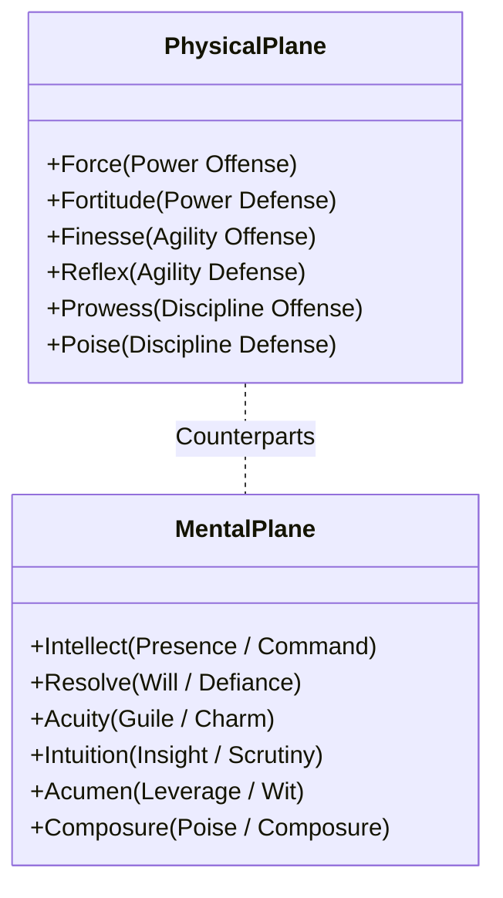

# The 12-Stat Vector Matrix and Opposed Contests

Fornach abandons generic RPG attributes (such as Strength, Dexterity, Intelligence) in favor of a mathematically symmetrical **12-Stat Vector Matrix** (`Attributes.fs`). The matrix structures all physical actions, mental/arcane disciplines, and social engagements into orthogonal planes, vectors, and orientations.

## The Vector Matrix Grid

The matrix defines twelve attributes across two primary planes (`Physical` and `Mental`) and three dynamic vectors (`Power`, `Agility`, `Discipline`), partitioned into paired `Offense` and `Defense` orientations:

| Plane | Vector | Orientation | Canonical Stat | Social Nomenclature | Counterpart |
| :--- | :--- | :--- | :--- | :--- | :--- |
| **Physical** | `Power` | Offense | **Force** | Force | Intellect |
| **Physical** | `Power` | Defense | **Fortitude** | Fortitude | Resolve |
| **Physical** | `Agility` | Offense | **Finesse** | Finesse | Acuity |
| **Physical** | `Agility` | Defense | **Reflex** | Reflex | Intuition |
| **Physical** | `Discipline` | Offense | **Prowess** | Prowess | Acumen |
| **Physical** | `Discipline` | Defense | **Poise** | Poise | Composure |
| **Mental** | `Power` | Offense | **Intellect** | Presence / Command | Force |
| **Mental** | `Power` | Defense | **Resolve** | Will / Defiance | Fortitude |
| **Mental** | `Agility` | Offense | **Acuity** | Guile / Charm | Finesse |
| **Mental** | `Agility` | Defense | **Intuition** | Insight / Scrutiny | Reflex |
| **Mental** | `Discipline` | Offense | **Acumen** | Leverage / Wit | Prowess |
| **Mental** | `Discipline` | Defense | **Composure** | Poise / Composure | Poise |

## Opposed Contest Resolution

Every strike, parry, counter, and spell is evaluated as an opposed dice pool contest (`DicePool.fs`).

### 1. Pool Size Calculation
Rather than rolling fixed quantities, participants construct dynamic pools clamped between 4 and 20 six-sided dice (d6) based on relative stat competence:
$$\text{PoolSize} = \text{clamp}\left(4, 20, \left\lfloor 6.0 + 4.0 \times \frac{\text{StatValue}}{\max(1.0, \text{OpponentStat})} \right\rceil\right)$$

### 2. Guaranteed Floor Hits
To reward high investment and eliminate total variance failure for masters, combatants receive deterministic floor hits:
$$\text{FloorHits} = \left\lfloor\frac{\text{StatValue}}{15}\right\rfloor$$
A combatant with 45 Force begins with 3 guaranteed hits before a single die is rolled.

### 3. Vector Hit Mechanics
Each vector implements specialized success criteria on rolled d6 dice:
- **Power Vector**: Explosive risk. Target Number 5+. A roll of 5 yields 1 hit; a roll of 6 yields **2 hits** (exploding kinetic damage).
- **Agility Vector**: High consistency and volume. Target Number 4+. Rolls of 4, 5, and 6 each yield 1 hit.
- **Discipline Vector**: Methodical precision. Target Number 4+. Rolls of 4, 5, and 6 yield 1 hit. Furthermore, if the combatant possesses **Study Stacks** ($> 0$), up to `StudyStacks` rolled 1s are rerolled.

### 4. Contest Outcome
Total hits are summed ($\text{TotalHits} = \text{FloorHits} + \text{RolledHits}$) for both attacker and defender:
$$\text{NetHits} = \text{AttackerTotalHits} - \text{DefenderTotalHits}$$

- $\text{NetHits} > 0$: **Hit Landed**. Damage is applied to Health or Morale.
- $\text{NetHits} \ge 3$: **Critical Strike**. Explores vital openings, activates item crit procs, and increases bleed or confusion.
- $\text{NetHits} \le 0$: **Deflection / Whiff**. Strike misses or glance harmlessly off armor.
- **Glitch**: If more than half the rolled dice show 1s, the action triggers a combat mishap, spiking Recklessness or incurring weapon degradation.
