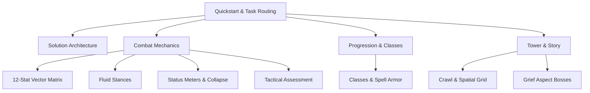

# Quickstart and Task Routing

Welcome to the **Fornach** repository documentation. Fornach is an extensible, functional combat simulation engine, roguelike dungeon crawler, and balance workbench written in F# for .NET 10.

This guide provides immediate orientation for human engineers and autonomous AI agents, routing common development tasks directly to their authoritative system documentation.

## System Map and Documentation Directory

The knowledge wiki is organized around core domain, combat, progression, and spatial systems:

| Category | Wiki Page | Description |
| :--- | :--- | :--- |
| **Architecture** | [Solution Architecture](architecture/overview.md) | 8-project hierarchy, dependency layering, build policies, and project seams. |
| **Combat** | [12-Stat Vector Matrix](combat/vector-matrix.md) | Symmetrical 12-stat grid, Power/Agility/Discipline axes, dice pools, and floor hits. |
| **Combat** | [Fluid Stances & Complex Forms](combat/fluid-stances.md) | Automatic stance shifting on attack, stat multipliers, off-vector penalties, and forms. |
| **Combat** | [Status Meters & Collapse](combat/status-meters.md) | The 7 dynamic entropy gauges, 100% collapse thresholds, execute states, and breathing. |
| **Combat** | [Tactical Assessment & Threats](combat/tactical-assessment.md) | Acumen vs. Composure scrutiny tiers, weakness revelation openings, and apex threat HUD. |
| **Progression**| [Classes, Progression & Spell Armor](progression/classes-and-progression.md) | Player archetypes, Level 1–200 scaling, Level 49 physical caps, and Spell Armor. |
| **Tower** | [Tower Crawl & Spatial Grid](tower/crawl-and-spatial.md) | 2D Point math, recursive shadowcasting FOV, Fog of War memory, and encounter triggers. |
| **Tower / Story**| [Grief Aspect Bosses](tower/bosses-and-story.md) | Psychological trauma themes, the 5 Grief Aspect bosses, Ink narrative engine, and duels. |



## Task-Routing Guide: Where to Start

When approaching a specific modification or feature, consult the following routes:

### 1. Working on Combat Mechanics or Damage Calculation
- **If adjusting opposed rolls, dice pool sizing, or TN mechanics**: See [The 12-Stat Vector Matrix](combat/vector-matrix.md) and inspect `src/Fornach.Engine/DicePool.fs`.
- **If tuning stance shifts or action effects**: See [Fluid Stances and Complex Forms](combat/fluid-stances.md) and inspect `src/Fornach.Engine/ActionResolver.fs`.
- **If modifying status strain, exhaustion, or collapse states**: See [Status Meters and Collapse Mechanics](combat/status-meters.md) and inspect `src/Fornach.Domain/Meters.fs` and `src/Fornach.Domain/Collapse.fs`.
- **If adjusting enemy stat perception or threat warnings**: See [Tactical Assessment and Threat Warnings](combat/tactical-assessment.md) and inspect `src/Fornach.Domain/TacticalAssessment.fs`.

### 2. Working on Classes, Equipment, or Balancing
- **If adding or tuning player classes, stat growth curves, or Spell Armor**: See [Classes, Progression, and Spell Armor](progression/classes-and-progression.md) and inspect `src/Fornach.Domain/Classes.fs` and `src/Fornach.Domain/TierFactory.fs`.
- **If balancing archetypes or running Monte-Carlo simulations**: Inspect `src/Fornach.Cli/Simulation.fs` and tests in `tests/Fornach.Tests/ClassBalanceTests.fs`.

### 3. Working on the Roguelike Dungeon or Narrative Story
- **If editing spatial geometry, field-of-view, or grid distance**: See [Infinite Tower Crawl and Spatial Navigation](tower/crawl-and-spatial.md) and inspect `src/Fornach.Spatial/`.
- **If working on tower floor generation, hazards, or session loops**: Inspect `src/Fornach.Engine/TowerGenerator.fs` and `src/Fornach.Engine/TowerSession.fs`.
- **If editing story encounters, Ink scripts, or Grief Aspect bosses**: See [Grief Aspect Bosses and Story Duel Engine](tower/bosses-and-story.md) and inspect `src/Fornach.Story/` and `src/Fornach.Domain/Bosses.fs`.

## Common CLI Workflows

All development workflows run via the standard .NET CLI from the repository root:

```bash
# Build the entire solution (enforces TreatWarningsAsErrors)
dotnet build

# Execute all 3 test projects
dotnet test

# Launch the interactive Spectre.Console terminal UI
dotnet run --project src/Fornach.Cli
```
