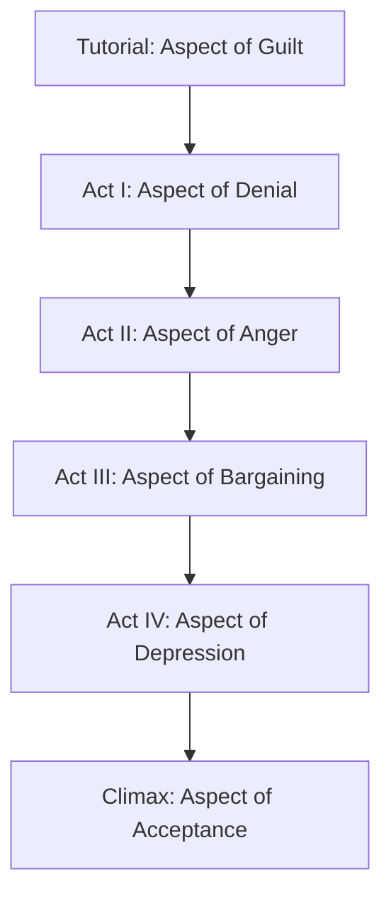

# Grief Aspect Bosses and Story Duel Engine

Fornach frames its procedural tower and story campaign around psychological reckoning. Adversaries encountered in the story mode (`Fornach.Story` and `Bosses.fs`) represent fractured aspects of memory, trauma, and the Kübler-Ross grief cycle, each mapped to specific vector archetypes and status dynamics.

## The Five Grief Aspects

### 1. Aspect of Denial (`Shrouded Grove`)
- **Dominant Vector**: `Agility` (Finesse 235, Reflex 240, Acuity 210, Intuition 210)
- **Equipment**: *Twin Mirage Daggers*, *Veil of Distortions*, *Specter of Avoidance*
- **Tactical Mechanics**: Fights from `AgilityStance` with pre-spawned mirror decoy clones. Evades direct engagement and triggers Confusion debuffs on both dealt strikes and received hits.

### 2. Aspect of Anger (`Basalt Caldera`)
- **Dominant Vector**: `Power` (Force 270, Prowess 240, Fortitude 210)
- **Flaw**: **Composure 0** (consumed by unrestrained blind fury)
- **Equipment**: *Slag-Forged Greatsword*, *Molten Carapace*
- **Tactical Mechanics**: Starts in `PowerStance` with 45 Recklessness and 40 Frustration. Lands devastating cleaves that shred armor and inflict bleed trauma, but its zero Composure renders it acutely vulnerable to Acumen interrogation and tactical scrutiny.

### 3. Aspect of Bargaining (`Shattered Promontory`)
- **Dominant Vector**: `Discipline` / Mental (Intellect 260, Acumen 280, Acuity 250)
- **Equipment**: *Gale-Wind Rapier*, *Scales of Unequal Trade*
- **Tactical Mechanics**: Operates from `DisciplineStance`. Relies on transactional exchanges—every hit landed or sustained triggers morale restoration. Forces the player into attritional engagements that tax physical Exhaustion.

### 4. Aspect of Depression (`Sunken Metropolis`)
- **Dominant Vector**: Heavy Durability (Fortitude 310, Poise 290, Resolve 320, Composure 280)
- **Equipment**: *Anchor of Apathy*, *Shroud of Still Waters*
- **Tactical Mechanics**: Immense physical and mental resilience (3800 HP / 3800 Morale). Shrouded in waterlogged inertia, its attacks inflict massive Exhaustion (30%) and Cognitive Fatigue (40%), threatening Somatic Anoxia or Catatonic Stupor unless countered with Steady Breathing.

### 5. Aspect of Acceptance (`White Meadow`)
- **Dominant Vector**: Harmonious Balance across all 12 stats (Resolve 310, Intuition 300, Composure 300, all physical stats 200–240)
- **Equipment**: *Unfinished Crossing Staff*, *Linen of White Lilies*, *Keepsake Pendant*
- **Tactical Mechanics**: Unblemished poise with zero initial meter entropy. Restores both Health and Morale continuously upon landing hits and absorbing blows. Requires masterful tactical stance weaving and flaw exploitation to subdue.

## The Tutorial: Aspect of Guilt (`Quarry Pit`)

Before ascending the Tower, players face the **Aspect of Guilt** in the quarry pit tutorial. Wielding the *Quarry Sledgehammer* and *Rusted Heavy Plate*, Guilt teaches kinetic defense: high structural Fortitude (195) and Poise (185), demonstrating how heavy armor absorbs raw damage and introducing the necessity of armor shredding and poise disruption.

## Story Duel Integration

Story encounters are initiated from `Program.fs` via `StoryRunner` (`Fornach.Story`):
1. **Interactive Ink Dialogue**: Branches scripted in Ink present choices, emotional responses, and character backstory.
2. **Seamless Duel Transition**: When confrontation occurs, `runStoryDuel` takes over, binding the custom boss combatant record into the tactical duel loop.
3. **Resolution**: Defeating an Aspect progresses the story script, awards relic items, and updates the narrative chronicle.
