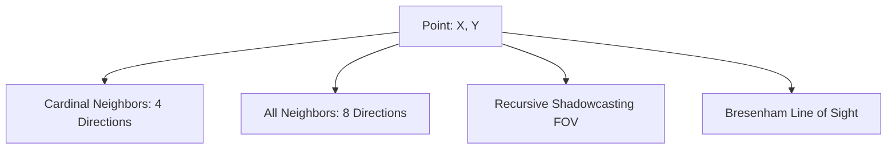

# Infinite Tower Crawl and Spatial Navigation

Ascending the Infinite Tower combines roguelike spatial navigation with tactical combat initiation. The spatial engine (`Fornach.Spatial`) manages tile coordinate math, raycasting, and field-of-view, while `TowerSession.fs` drives the procedural crawl loop, enemy patrols, and terminal rendering.

## 2D Spatial Grid Coordinates (`Fornach.Spatial`)

Grid positions are encapsulated by the immutable struct `Point` (`Point.fs`):
- **Vector Arithmetic**: Overloads `+`, `-`, and `*` for delta translations and directional offsets.
- **Cardinal Neighbors**: Generates the 4 orthogonal points (North, East, South, West) for movement costs.
- **All Neighbors**: Generates all 8 surrounding Chebyshev tiles (including diagonals) used for area of effect calculations and flanking encirclement.

## Field of View and Fog of War

Vision and perceptual awareness are modeled through continuous shadowcasting:
- **8-Octant Shadowcasting** (`Fov.fs`): Projects outward from the combatant's position using octant matrix transforms. It casts shadows past opaque walls, calculating slope bounds row by row.
- **Directional Vision Cones** (`VisionCone.fs`): Restricts visibility arcs according to combatant facing and locomotion (e.g., walking vs. sprinting vs. crouching).
- **Fog of War Memory** (`TowerSession.updateFov`): In each turn of the crawl loop, tiles currently inside the vision cone are added to `Visible`. These are unioned into `Explored` memory, ensuring mapped terrain remains visible as grayed-out memory even when line of sight is broken.

## Tower Session Loop and Aggro Dynamics

The crawl session (`TowerRunState` in `TowerSession.fs`) manages player movement, procedural floor generation, and entity interactions:

### 1. Enemy Proximity and Aggro
- **Aggro Radius**: Living enemies within a Chebyshev distance of `8` tiles that maintain an unobstructed line of sight (`Los.check`) take notice and pursue the player.
- **Combat Initiation**: When an enemy closes to adjacent range (Chebyshev distance `1`), `CombatTriggered` halts movement and initiates the turn-based duel or group encounter.
- **Encirclement & Escape**: If adjacent enemies occupy all surrounding walkable tiles, `canEscape` returns false, inflicting encirclement penalties on defense rolls.

### 2. Interactive Floor Elements
Floors generated by `TowerGenerator.fs` feature rich procedural elements:
- **Locked Doors & Stairways**: Require specific keys discovered on the floor or dropped by elite sentinels.
- **Chests & Vaults**: Contain weapon upgrades, armor pieces, and alchemical trophies.
- **Shrines & Altars**: Offer blessings, morale restoration, or high-risk risk/reward gambits.
- **Memory Echoes**: Narrative fragments that uncover the lore of previous climbers and the Tower's origin.

## Terminal Rendering with Spectre.Console

The dungeon viewport (`TowerDisplay.fs`) renders the grid using `Spectre.Console`:
- Supports Vim-standard movement keys (`h/j/k/l`, `y/u/b/n` for diagonals) and fast travel.
- Real-time sidebars display player Health, Morale, 7 status meters, floor depth, active preparations, and inventory loadout.
- Inspect mode (`x`) allows players to scrutinize visible tiles, view enemy stat overviews, and assess apex threats prior to engaging.
